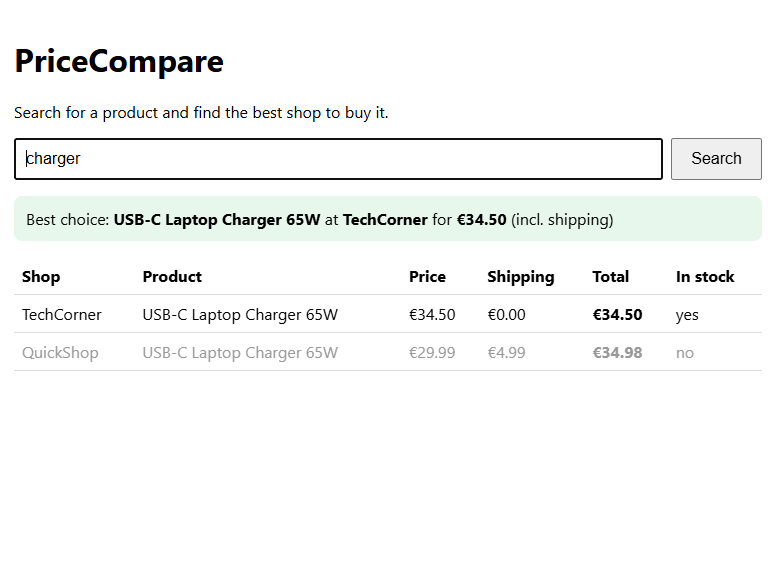

# PriceCompare 🛒

A small web app that compares prices from several shops and shows you
**the best place to buy a product**: the cheapest offer that is in stock,
including shipping costs.

I always wanted a simple tool like this for my own shopping: search once,
see all shops side by side, and know right away where to buy.

> **Note:** for now the shops, products and prices are **made up**
> (`data/sample_shops.json`). Connecting to real shops through official
> sources (the bol.com affiliate API and affiliate product feeds) is on the
> [roadmap](ROADMAP.md).

## Who is it for?

Anyone who wants to compare prices quickly before buying something online,
and developers who want a small, clean example of a FastAPI project with
pluggable data sources.

## Features

- Search any product by name or category
- Compare price, shipping and stock across shops
- "Best choice" = cheapest **total price** among in-stock offers
- Simple web page **and** a JSON API
- Each shop is a separate *adapter*, so new shops are easy to add


## Built with

- Python 3.10+
- [FastAPI](https://fastapi.tiangolo.com/) + Uvicorn
- pytest

## Install and run

```bash
git clone https://github.com/faezefz/pricecompare.git
cd pricecompare
python -m venv .venv
# Windows: .venv\Scripts\activate    Mac/Linux: source .venv/bin/activate
pip install -r requirements.txt
uvicorn pricecompare.app:app --reload
```

Then open <http://127.0.0.1:8000> and search for e.g. `headphones`.

## API

```
GET /api/search?q=headphones
```

Example response (shortened):

```json
{
  "query": "headphones",
  "count": 3,
  "best": {"shop": "QuickShop", "product": "Wireless Headphones X200", "total_price": 82.0},
  "offers": [ ... ]
}
```

Interactive API docs: <http://127.0.0.1:8000/docs>

## Project structure

```
pricecompare/
  models.py        # Offer data model
  compare.py       # search all shops, rank offers, pick the best
  app.py           # FastAPI web page + JSON API
  shops/
    base.py        # ShopAdapter interface
    sample.py      # adapter that reads made-up data from JSON
data/sample_shops.json
tests/
```

## Adding a new shop

Write a class with a `name` and a `search(query)` method that returns a list
of `Offer` objects (see `pricecompare/shops/base.py`), then add it to the
list of shops in `app.py`.

## Run the tests

```bash
python -m pytest
```

## Roadmap

See [ROADMAP.md](ROADMAP.md) and the open issues.

## License

[MIT](LICENSE)